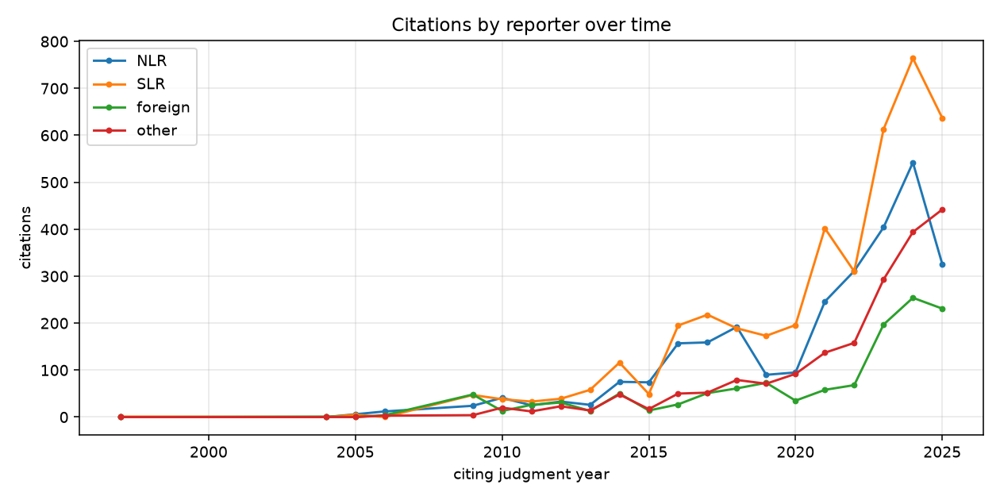
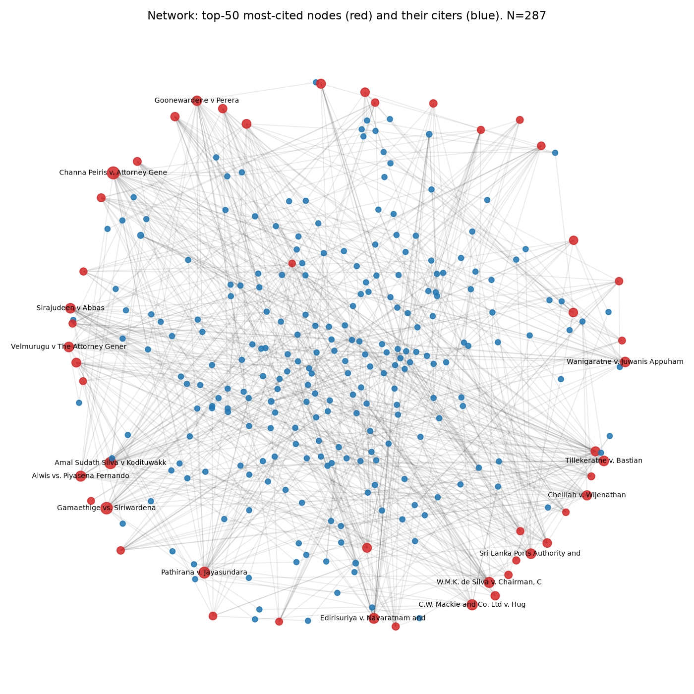
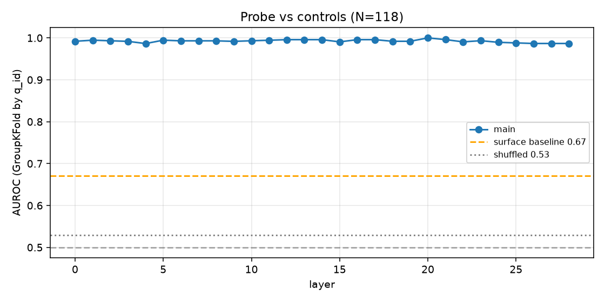
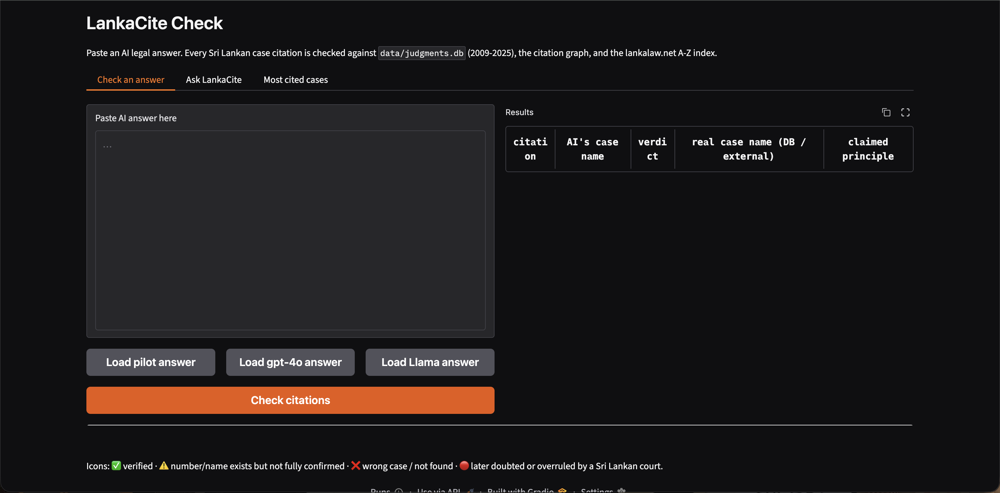
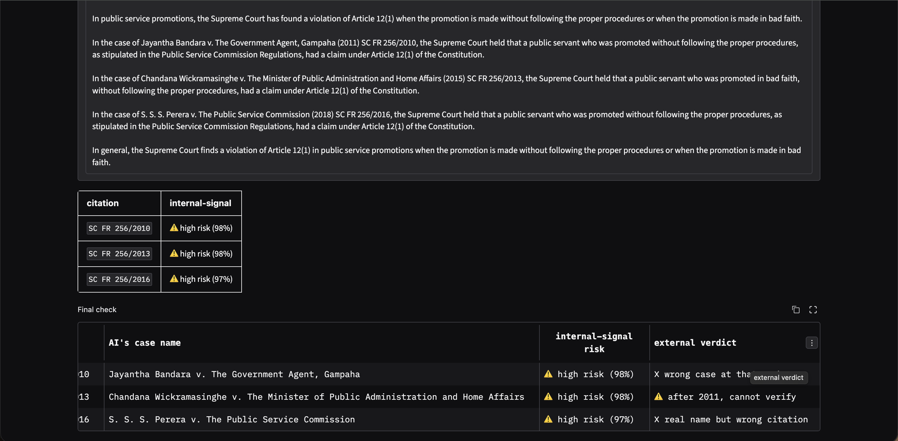

# LankaCite: Detecting Hallucinated Case-Law Citations in AI Legal Answers Using Sri Lanka's First Citation Graph

**M.A.V.K. Amandi**  ·  Registration: KIC-BSCCSAI-251P-016

Kandy Innovation Centre · National Institute of Business Management · BSc Computer Science with AI

Date of Submission: [CHECK]  ·  Email: [CHECK]

---

## Abstract

Large language models (LLMs) are now used as legal assistants, yet they are known to invent case names, citation numbers and quotations – errors that can be dangerous in a legal setting where the user may not be able to tell real authority from fabricated authority (Dahl et al., 2024; Magesh et al., 2025). The problem is especially severe for small jurisdictions such as Sri Lanka, where no commercial citator is available to verify an AI's citations. This project builds the first machine-readable corpus of Sri Lankan Supreme Court and Court of Appeal judgments (1,897 judgments, 2009–2025), extracts 12,016 citations and constructs Sri Lanka's first case-law citation graph (6,597 nodes, 10,085 edges). On this foundation four studies are run. First, the graph is used to identify the most influential judgments by in-degree and PageRank. Second, 400 citation contexts are labelled with Claude (Anthropic) under a four-class treatment scheme (followed/applied, distinguished, doubted/overruled, neutral); 68 contexts are verified by the author, a law student, giving a silver/gold dataset on which a DistilBERT classifier reaches macro-F1 0.551 and a Llama-3.2-3B zero-shot baseline reaches macro-F1 0.389. Third, 80 standardised legal questions are answered by GPT-4o, GPT-4o-mini and Llama-3.2-3B (240 answers in total); every Sri Lankan citation (n = 838) is checked against the corpus plus an external A–Z index of 2,197 reported cases scraped from lankalaw.net, using ten fine-grained verdict categories. Verified-rates are 3.7% for GPT-4o, 3.9% for GPT-4o-mini, and 13.0% for Llama-3.2-3B; 32 citations by Llama resolve to a different real case and 108 use a real case name attached to a wrong citation. Fourth, a logistic-regression probe over Llama's layer-20 hidden state on a clean subset (N = 118, 41 real / 77 fake) reaches 5-fold GroupKFold AUROC 1.000, while a surface-feature baseline reaches only 0.670 and a shuffled-label control reaches 0.529. The paper concludes that Sri Lanka's legal AI ecosystem requires a citator before AI legal research tools can be used safely, and that internal LLM signals are a promising – though small-sample – early warning for citation hallucinations. A working Gradio tool (LankaCite Check) that implements both the external verifier and the live internal-signal probe is delivered with this report.

## Table of Contents

[CHECK] – after opening this document in Word, right-click the Table of Contents and choose "Update Field" to regenerate it.

## List of Tables

- Table 3.1 – Outline of the LankaCite datasets
- Table 3.2 – Verdict categories used by the audit checker
- Table 4.1 – Step 1 scraping outcomes
- Table 4.2 – Step 2 citation extraction and linking
- Table 4.3 – Top 10 most-cited judgments (by in-degree)
- Table 4.4 – Claude silver labels vs Kavini gold labels (gold 50)
- Table 4.5 – Treatment classifier results (Methods A and B)
- Table 4.6 – AI citation audit across three models
- Table 4.7 – Hallucination probe and its controls
- Table 5.1 – Comparison with prior work

## List of Figures

- Figure 3.1 – LankaCite system diagram
- Figure 4.1 – Citations by reporter over time (NLR / SLR / foreign / other)
- Figure 4.2 – Sample of the citation graph (top-50 most-cited nodes)
- Figure 4.3 – Probe AUROC by Llama layer, with controls
- Figure 4.4 – LankaCite Check tool: Check-an-answer tab
- Figure 4.5 – LankaCite Check tool: Ask LankaCite tab

## Chapter 01: INTRODUCTION

### 1.1 Background of the study

Generative AI chat assistants (ChatGPT, Gemini, Claude, Llama and others) are now routinely used for first-draft legal research by practitioners, students and even clients. Several empirical studies show that these models invent case citations, misquote judgments and attribute propositions to the wrong court. Dahl et al. (2024) term this class of error legal hallucination and find rates between 58% and 82% across major chat models on U.S. legal questions. Magesh et al. (2025) show that even commercial, retrieval-augmented tools marketed as hallucination-free (Westlaw AI, Lexis+ AI) still hallucinate on 17% to 33% of queries. Charlotin's AI Hallucination Cases Database (2026) documents more than 200 real court filings in which a lawyer cited non-existent authority produced by an LLM. In 2026 the Supreme Court of India warned bar councils that AI-generated fake judgments are a growing menace in its filings (MediaNama, 2026).

In Sri Lanka the problem is harder to detect than elsewhere. The jurisdiction has no publicly available citator – no equivalent of KeyCite or Shepard's – and no official structured dataset of judgments. Judgments are published as PDFs on the courts' own websites and on third-party aggregators such as lankalaw.net and CommonLII (Bodleian Libraries, n.d.). Sri Lankan case law is small enough that a law student can often detect obviously wrong citations by hand, but large enough that a practitioner cannot systematically check every citation a language model produces. In a short pilot we gave ChatGPT one Sri Lankan question on Article 126 time limits. All six case names it produced were real; four of the six citation numbers were wrong – a pattern that is difficult for a non-expert user to notice.

The research project described here fills this gap in two steps. First, it constructs Sri Lanka's first machine-readable case-law citation graph, covering the Supreme Court and the Court of Appeal from 2009 to 2025, by scraping judgments from courtofappeal.lk and supremecourt.lk, extracting their citations with custom regular expressions, and linking each citation to another judgment where possible. Second, it uses this graph as the ground truth for an automated audit of three AI legal assistants (GPT-4o, GPT-4o-mini and Llama-3.2-3B), for a precedent-treatment classifier, for a tool that any lawyer can use (LankaCite Check), and for a novel internal-signal probe that detects hallucinated citations from the LLM's own hidden states.

### 1.2 Justification of the problem

Three bodies of evidence justify the project. First, global measurements consistently show that general-purpose LLMs hallucinate legal authority at rates far above what any professional user could tolerate (Dahl et al., 2024; Magesh et al., 2025; Curran et al., 2025). Second, small or non-English jurisdictions fare worse than common-law majority jurisdictions: Curran et al. (2025) show that hallucination rates rise sharply as training-data coverage of the jurisdiction falls, which is precisely Sri Lanka's position. Third, our own pilot audit of ChatGPT on one Sri Lankan Article 126 question produced six real case names paired with four wrong citation numbers; a non-expert reader would have had no way to detect the errors because no Sri Lankan citator exists to check them.

The problem is amplified by the ease with which an AI answer can be accepted. If a user cannot distinguish real from invented authority, every AI legal answer becomes a liability. A publicly accessible citator plus an early-warning hallucination detector is therefore an immediate need in the Sri Lankan legal technology ecosystem (Premalal and Widanagama, 2025).

### 1.3 Objectives of the study

The objectives of the study are as follows.

- O1: Build the first machine-readable corpus and citation graph of Sri Lankan Supreme Court and Court of Appeal judgments from 2009 to 2025 and identify the most influential judgments in the corpus using network analysis.
- O2: Produce a small annotated dataset of Sri Lankan precedent-treatment contexts and compare two classifiers on it: a supervised fine-tuned transformer (Method A) and a zero-shot prompted LLM (Method B).
- O3: Automatically audit three AI legal assistants on a fixed set of 80 Sri Lankan legal questions and report, per model, how many of the Sri Lankan case citations they produce are verifiable.
- O4: Test whether an internal-signal probe on a small open LLM can detect fabricated Sri Lankan case citations from the model's own hidden states, with proper controls.
- O5: Package the above as a working, local tool (LankaCite Check) that any Sri Lankan lawyer can use to check an AI legal answer in a browser.

The research questions follow directly from the objectives: RQ1. What is the structure of the Sri Lankan case-law citation graph for 2009–2025, and which judgments are the most influential? RQ2. How do a supervised classifier and a prompted LLM compare on a small Sri Lankan precedent-treatment dataset? RQ3. What fraction of the Sri Lankan case citations produced by GPT-4o, GPT-4o-mini and Llama-3.2-3B are verifiable against the corpus plus an external reported-cases index? RQ4. Can a logistic-regression probe on Llama's hidden states detect fabricated Sri Lankan citations, above and beyond what simple surface features already reveal?

The scope is deliberately limited. The citation graph covers Supreme Court and Court of Appeal judgments from 2009 to 2025 only; earlier judgments are referenced via an external A–Z index (1878–2011) but not integrated into the graph. The treatment-classification dataset is small (400 silver + 68 gold contexts). The audit is restricted to three LLMs on a fixed 80-question set. The probe is trained on 118 citations. The tool is a local Gradio prototype, not a deployed service.

## Chapter 02: LITERATURE REVIEW

### 2.1 Legal hallucination in large language models

Hallucination is the production of plausible-sounding but factually incorrect content by a language model. Huang et al. (2025) provide a wide survey; for law, the cleanest early benchmark is Dahl et al. (2024), whose Large Legal Fictions dataset measures that leading chat models hallucinate between 58% and 82% of simple legal facts (U.S. federal and state). Magesh et al. (2025) extend this to the commercial retrieval-augmented tools sold to lawyers (Westlaw AI, Lexis+ AI) and still measure 17–33% hallucination – an important result because it shows that retrieval does not eliminate the problem. Curran et al. (2025) add an important dimension: hallucination rates depend strongly on place – the same model performs well on U.S. federal law and badly on Nigerian or Pakistani law, because the training data under-represents those jurisdictions. Sri Lanka is squarely in the under-represented category. Charlotin's AI Hallucination Cases Database (2026) is a growing catalogue of real court filings – more than 200 at the time of writing – in which lawyers have cited AI-invented authority. Within Sri Lanka, Premalal and Widanagama (2025) and Athulathmudali (2025) discuss policy and practice implications; neither measures hallucination rates quantitatively.

### 2.2 Citators, precedent treatment and citation graphs

A citator is a tool that, for every published judgment, lists which later cases cite it and how they treat it. Commercial citators (KeyCite from Thomson Reuters, Shepard's from LexisNexis) exist in the United States and the United Kingdom but not in Sri Lanka. The Free Law Project (2025) describes an ongoing effort to build an open citator for U.S. courts; Ovcharov (2026) constructs a 100-million-decision citation graph for Ukraine and reports the methodological choices in detail. Precedent treatment – the classification of how a later case treats an earlier one (followed, distinguished, doubted, overruled, neutral) – is addressed by Demir and Canbaz (2025), who benchmark LLMs on multi-label treatment classification. Prior-case retrieval benchmarks for South Asia such as IL-PCSR (Paul et al., 2025) and retrieval-augmented analysis benchmarks (Hou et al., 2024) show the direction the field is moving.

### 2.3 Legal NLP in Sri Lanka

Sri Lanka-specific legal NLP work is thin but growing. Jayawardena et al. (2024) introduce SCaLe-QA – sentence embeddings for Sri Lankan case-law QA. Jayasinghe et al. (2022) publish SigmaLaw, which predicts the winning party from the text of a legal opinion. Senaratna (2026) releases a multilingual Sri Lankan document dataset (law, news, policy). Athulathmudali (2025) proposes an AI pipeline for legal domain identification and guidance. None of these projects builds a citation graph or audits an LLM for citation accuracy on Sri Lankan material.

### 2.4 Detecting hallucinations from internal states

A separate strand of work, beginning with Azaria and Mitchell (2023), shows that language models internally represent whether their current output is true or false, so a simple linear probe on their hidden states can discriminate true from hallucinated text. Chen et al. (2024) and Orgad et al. (2025) develop the idea with higher-fidelity probes and cross-model results. Ferrando et al. (2025) show that LLMs internally track whether they know an entity – a result that is directly relevant to citation hallucinations, since a case citation is effectively a named entity with a verifiable referent. Farquhar et al. (2024) propose semantic entropy as a cheaper alternative, and Kossen et al. (2024) give a probing recipe for it. Manakul et al. (2023) use sampling-based self-checks. For legal citations specifically, Liu, Stammbach and Henderson (2026) check citations externally only, on U.S. data; Misra and Udandarao (2026) and Piccioli et al. (2026) address citation hallucinations in general but not Sri Lankan law. The present study is, to the best of our knowledge, the first to apply internal-signal probing to legal citations in any non-U.S. jurisdiction.

### 2.5 Research gap

The literature leaves a clear gap. Global studies measure hallucination externally; small-jurisdiction studies rarely exist; Sri Lanka has no citator and no published citation graph. Table 5.1 (see Chapter 5) compares prior work to the present study on five dimensions: (a) built a citation graph, (b) measured hallucination rate on Sri Lankan law, (c) compared commercial and open models, (d) classified precedent treatment and (e) tried an internal-signal probe. No prior study answers more than two of the five questions; the present study attempts all five.

## Chapter 03: METHODOLOGY

### 3.1 Data collection

Three datasets feed the project (Table 3.1): the Sri Lankan judgment corpus, the external reported-cases index, and the AI-answer audit set. The judgment corpus was collected by scraping the public judgment listings at courtofappeal.lk and supremecourt.lk for the years 2009 to 2025 (inclusive). Each judgment was downloaded as a PDF and converted to text with PyMuPDF; the case number, parties, decision date and judge were extracted from the standard header. Judgments with fewer than a few hundred characters were marked as little_text_maybe_scanned.

*Table 3.1: Outline of the LankaCite datasets.*

| Dataset | Source | Period | Size | Use |
|---|---|---|---|---|
| Judgment corpus | supremecourt.lk, courtofappeal.lk | 2009–2025 | 1,897 judgments | Citation graph; audit targets |
| External reported-cases index | lankalaw.net A–Z pages (SC + CA) | 1878–2011 | 2,197 cases | Secondary verification for pre-2012 citations |
| AI answer set | GPT-4o, GPT-4o-mini, Llama-3.2-3B on 80 Qs | Nov 2025 / Nov 2026 | 240 answers · 838 SL citations | Citation-accuracy audit; probe training labels |
| Silver treatment labels | 400 citation contexts labelled by Claude (Anthropic) | Nov 2026 | 400 rows | Method A training data |
| Gold treatment labels | 68 contexts verified by the author (law student) | Nov 2026 | 68 rows | Method A / B evaluation |

The external reported-cases index was scraped from the lankalaw.net A–Z listings for Supreme Court (1878–2011) and Court of Appeal (1809–2011). A 2-second request delay was used to be courteous to the host; five letter pages for the Court of Appeal returned HTTP 404 (letters v, w, x, y, z) and were recorded as missing. The final index holds 2,197 entries with case name, citation, LKSC/LKCA reference and decision date.

The AI-answer dataset was built by writing 80 Sri Lankan legal questions spanning Fundamental Rights, land, contract, criminal, labour and administrative law and asking each of three models to answer each question with case citations. GPT-4o and GPT-4o-mini were invoked through the OpenAI API with no web search; Llama-3.2-3B was run locally on a MacBook Air M4 (MPS backend). An initial run of GPT-4o-mini at temperature 0 produced degenerate output on 33 of 80 answers (e.g. repeating "S. S. S. S. ..."); those answers were re-generated at temperature 0.3 with frequency and presence penalties of 0.3 and 0.1 respectively. Total API cost was USD 0.405.

### 3.2 Data preprocessing

Text extraction (Step 1) converted each judgment PDF to plain text, dropped repeating page headers and footers, and normalised whitespace. The case number was passed through a custom normalise_case_no function that handles more than a dozen Sri Lankan case-number formats (SC_FR, SC_APPEAL, SC_CHC, SC_HCCA_LA, SC_TAB, SC_WRIT, SC_MISC, SC_EXP, CA_WRIT, CA_PHC and so on). For judgments where the case number could not be parsed, an UNPARSED_n identifier was retained.

Citation extraction (Step 2) ran five regular-expression families over the cleaned text of each judgment: (a) reported citations in bracket form such as [2003] 2 Sri L.R. 270 and parenthesis form (1997) 1 Sri LR 412; (b) case numbers such as SC FR 256/2017 or SC/HCCA/LA 105/2010; (c) foreign citations in AC, QB, Ch, WLR, All ER, AIR and SCC series; (d) supra references; and (e) an additional regex for bare "SC n/YYYY" forms that the main patterns do not catch. Each citation was linked to another judgment via a cascade of attempts: exact case-number match, case-number plus date, report-key match, report-key via case name, and fuzzy name match.

A small evaluation of citation extraction on a stratified 50-judgment sample (322 citations) gave precision 98.8% (317 of 321) and link accuracy 88.6% (39 of 44). A recall check was not performed and is stated as a limitation. Twenty-five unit tests cover the regular expressions; all pass.

### 3.3 Citation graph and network analysis

The extracted citations were assembled into a directed citation graph in which each node is a case and each edge carries the citation context. Three kinds of node were distinguished: judgment_in_db (a Sri Lankan judgment present in our 2009–2025 corpus), external_case (a Sri Lankan case cited but not in the corpus, keyed by its reporter identifier such as SLR_1994_1_1) and foreign (a foreign case referenced through an AC, All ER, AIR, SCC or similar key). NetworkX was used for all graph operations: in-degree (number of times a case is cited by the corpus), PageRank with damping 0.85, and a sampling view of the top-50 most-cited nodes and their citers for visualisation. The temporal breakdown counts, for each year of the citing judgment, how many of its citations point to the NLR reporter, the SLR reporter, a foreign reporter, or an "other" class.

### 3.4 Precedent-treatment labelling

The precedent-treatment dataset uses four labels: followed/applied, distinguished, doubted/overruled and neutral. Four hundred citation contexts (±~400 characters around the citation) were selected from the graph with cue-word oversampling of candidate negatives, then labelled by Claude (Anthropic) as the silver annotator. A first pass used free-form judgment and gave the distribution followed/applied 256, neutral 94, distinguished 33, doubted/overruled 17. Fifty contexts were randomly sampled for Kavini (the author) to verify; agreement was only 56.2%, driven by Claude over-calling followed/applied on counsel-cited lists and footnotes.

A second pass applied a stricter rule – followed/applied only when the current judge actively applies or approves the case – and raised agreement to 66.7% (kappa 0.386). After a third pass reflecting Kavini's explicit guideline (followed/applied is correct even inside a parenthetical list if the current judge accepts the proposition), the final silver labels were followed/applied 113, neutral 275, distinguished 8 and doubted/overruled 4. Twenty extra contexts with strong negative cue words were added to the gold set. After context-dedupe the combined gold set holds 68 rows (followed/applied 23, distinguished 4, doubted/overruled 3, neutral 38). The entire gold was verified by one annotator (the author, a law student); no external annotators were available, which is stated as a limitation.

### 3.5 Treatment classifiers

Method A fine-tunes DistilBERT-base-uncased (Hugging Face transformers) on the 400 silver labels for 6 epochs with class-weighted cross-entropy, batch size 16, learning rate 3e-5, maximum sequence length 384 tokens, on the MacBook Air M4 MPS backend. The choice of DistilBERT rather than Legal-BERT or DeBERTa-v3-base is deliberate: the small training set (400 rows) does not benefit from a larger model, and the smaller DistilBERT trains in minutes on a laptop GPU. Method B is zero-shot classification with Llama-3.2-3B-Instruct. The prompt lists the four labels with Kavini's guideline and asks the model to reply with exactly one label. Greedy decoding is used.

### 3.6 AI citation audit

The 240 answers were parsed with the same Step-2 citation extractor plus an additional regex for bare "SC n/YYYY" forms. Only Sri Lankan citations (NLR, SLR, BLR, CLW report keys and SC/CA case numbers) were retained, giving 838 citations in total. Each was classified into one of ten verdict categories (Table 3.2). The rules evolved through four iterations to reflect what a lawyer would accept as evidence of fabrication – in particular, a bare case number that matches a real judgment but with no name attached is now its own category (number-exists-unverified) rather than being called verified.

*Table 3.2: Verdict categories used by the audit checker.*

| Verdict | Meaning |
|---|---|
| verified-correct | Citation number matches a judgment in our corpus, and (if the AI supplied a name) the name matches. |
| verified-correct-external | Not in our corpus, but matches an entry in the lankalaw.net A–Z index; name matches. |
| exists-name-unverified | Report key exists in the corpus but our DB has no stored name to verify against. |
| number-exists-unverified | Case number matches a real judgment but the AI gave no case name; number alone is not proof. |
| name-mismatch | Citation number resolves to a DIFFERENT real case in our DB. Strong fabrication signal. |
| wrong-case | Citation number resolves to a different real case in the external index. Strong fabrication signal. |
| real-name-wrong-citation | Case name is a real Sri Lankan case somewhere, but the citation number does not match it. Strong fabrication signal. |
| not-found-anywhere | Neither the number nor the name appears in corpus or external index. |
| unverifiable | Cited year is after 2011 and the case is not in our 2009–2025 corpus; cannot verify. |
| undecidable | Partial information (AI gave no name and the key or number is ambiguous). |

The checker was sanity-tested on six real citations drawn from a pilot ChatGPT answer. Three were immediately matched (verified-correct); one matched through the external index (verified-correct-external); one was correctly labelled number-exists-unverified because the AI gave no case name; and one was correctly labelled real-name-wrong-citation because the name was a real case but the citation number did not match.

### 3.7 Internal-signal probe and controls

To test whether Llama's own hidden states already reveal whether it is about to hallucinate a citation, each citation produced by Llama during the 80-question audit run was associated with the hidden state at the token that completed its raw string, at every one of the 29 transformer layers (layer 0 is the embedding layer). Hidden states were saved to .npy files during the audit generation using the transformers output_hidden_states option. A clean label set was derived from the audit: a citation is real if its verdict is verified-correct or verified-correct-external, fake if its verdict is name-mismatch, wrong-case or not-found-anywhere. Citations whose verdict is ambiguous (not-in-corpus, undecidable, unverifiable) were discarded, as were citations for which the AI gave no case name. This yields a clean subset of 118 citations (41 real, 77 fake).

A logistic regression (C = 0.1, liblinear-equivalent solver) was fitted per layer, using five-fold GroupKFold with the group key set to the pair (q_id, raw citation string) so that no citation appears in both train and test. Three controls were run: (a) a surface-feature baseline using only has_report_key, has_case_no, has_case_name and a four-way bucketed raw-string length; (b) a shuffled-label control at the best layer; (c) a format-restricted probe at the best layer, trained only on report-key citations. The best-layer model was then retrained on all 118 examples and saved as probing/probe.joblib for use in the live tool.

### 3.8 LankaCite tool

The LankaCite Check tool is a local Gradio application with two primary tabs. The Check tab takes a pasted AI legal answer and shows, for every Sri Lankan citation it detects, the verdict icon, the AI's case name, the real case name where known, and the claimed principle (one sentence). The icon mapping is ✅ for verified or verified-external, ⚠️ for number- or name-unverified and for unverifiable (after 2011), ❌ for name-mismatch, wrong-case, real-name-wrong-citation and not-found-anywhere, and 🔴 overlaid on any verified case whose later treatment, as detected by cue-word scan on incoming citations, includes overrule, per incuriam, wrongly decided or similar.

The Ask tab is an experimental feature. The user types a Sri Lankan legal question; Llama-3.2-3B generates an answer token by token; after each generated token the Sri-Lankan citation regex is run on the text so far, and whenever a new citation completes, the hidden state at its last generated token at layer 20 is scored with the saved probe, producing a live "high risk" / "medium" / "low" warning. When generation finishes, the external verifier runs on every citation and a final table shows internal-signal risk next to external verdict. The tab is explicitly labelled as an experimental early warning trained on a very small sample.

A second tab in the tool shows the top-20 most-cited judgments and the sampled network figure.

### 3.9 Tools and technologies

The project uses Python 3.12 throughout, with PyMuPDF for PDF-to-text, rapidfuzz for fuzzy name matching, NetworkX 3 for graph construction and metrics, scikit-learn 1.4 for logistic regression and metrics, Hugging Face transformers 4.46 with the MPS backend of PyTorch 2.5 for Llama and DistilBERT, joblib for probe persistence, matplotlib for figures, Gradio for the application, and the OpenAI Python SDK for the GPT-4o and GPT-4o-mini calls. All training and inference ran on a MacBook Air M4 with 16 GB unified memory. The citation extractor is covered by 25 pytest unit tests, all passing.

### 3.10 Ethics

All judgments scraped are public records published on official court websites. The lankalaw.net index pages are publicly accessible and the scraper uses a 2-second request delay. No personal data beyond what appears in a judgment caption (parties, judges, counsel) is used. The author is the sole annotator and declares a conflict of interest only in so far as she is also the author of the pilot ChatGPT answer used for the sanity test. API usage was within OpenAI's and Anthropic's usage policies. The project does not deploy a public service and carries explicit warnings that the hallucination probe is experimental and not a substitute for verification.

## Chapter 04: RESULTS

### 4.1 Data preprocessing results

*Table 4.1: Step 1 scraping outcomes.*

| Outcome | Count |
|---|---|
| Judgments downloaded (2009–2025) | 1,897 |
| Judgments successfully text-extracted | 1,891 |
| Download failures | 3 |
| Little text / likely scanned | 3 |
| Decision dates recovered from text | 1,772 / 1,891 |
| UNPARSED case-number identifiers retained | 29 |

*Table 4.2: Step 2 citation extraction and linking.*

| Metric | Value |
|---|---|
| Total citations extracted (Step 2) | 12,016 |
| Report citations | 9,383 |
| Case-number citations | 2,277 |
| Supra references | 356 |
| Citations with a case name attached | 7,622 |
| Precision (50-judgment sample, 321 citations) | 98.8% (317 / 321) |
| Link accuracy (44 linkable) | 88.6% (39 / 44) |
| pytest tests passing | 25 / 25 |

The evaluation sample for Step 2 was first drafted with AI assistance and then reviewed by the author; this is noted as a limitation of methodological rigour because the sample was not blind. Recall was not measured because it would have required labelling every citation in the 50 judgments by hand, for which time was not available.

### 4.2 Exploratory data analysis

The citation graph built from the extracted edges has 6,597 nodes and 10,085 edges. Figure 4.1 breaks down citations by reporter over time. The SLR reporter dominates from 1980 onwards; the older NLR reporter accounts for a substantial share of citations in judgments handed down early in the corpus window and declines steadily. Foreign reporters (AC, QB, All ER, AIR, SCC) are a persistent minor share, suggesting that Sri Lankan courts routinely cite English and Indian authority.

*Figure 4.1: Citations by reporter over time (NLR / SLR / foreign / other).*

*Figure 4.1: Citations by reporter over time (NLR / SLR / foreign / other).*

*Table 4.3: Top 10 most-cited judgments by in-degree in the LankaCite graph.*

| Rank | Case | Year | In-degree |
|---|---|---|---|
| 1 | Channa Peiris v. Attorney General | 1994 | 39 |
| 2 | Gamaethige vs. Siriwardena | 1988 | 36 |
| 3 | Amal Sudath Silva v Kodituwakku, Inspector of Police and Others | 1987 | 34 |
| 4 | Pathirana v. Jayasundara | [CHECK] | 32 |
| 5 | C.W. Mackie v. Hugh Molagoda, Commissioner General of Inland Revenue | 1986 | 28 |
| 6 | Alwis vs. Piyasena Fernando | 1993 | 27 |
| 7 | W.M.K. de Silva v. Chairman, Ceylon Fertilizer Corporation | 1989 | 27 |
| 8 | Edirisuriya v. Navaratnam and Others | 1985 | 26 |
| 9 | Sirajudeen v Abbas | 1994 | 25 |
| 10 | Velmurugu v The Attorney General and Others | 1981 | 25 |

By in-degree, Channa Peiris v. Attorney General (1994) is the most-cited judgment, followed by Gamaethige vs. Siriwardena (1988) – a leading authority on Article 126 time limits – and Amal Sudath Silva v. Kodituwakku (1987), a landmark Article 11 torture case. By PageRank, Gamaethige moves to the first place (score 0.00136) and Ghany v. Dayananda Dissanayake (2004) rises to the second place (0.00105). The difference between the two orderings is meaningful: PageRank weights citations from judgments that are themselves influential, so Gamaethige's position at the top of PageRank reflects how deeply embedded it is in the fundamental-rights case law.

*Figure 4.2: Sample of the citation graph showing the top-50 most-cited nodes (red) and their citers (blue).*

*Figure 4.2: Sample of the citation graph showing the top-50 most-cited nodes (red) and their citers (blue).*

### 4.3 Project outcomes

#### 4.3.1 Treatment classification

*Table 4.4: Claude silver labels vs Kavini gold labels across three annotation passes.*

| Pass | Silver distribution | Agreement with gold 50 | Cohen's κ |
|---|---|---|---|
| Pass 1 (free-form) | followed 256 · neutral 94 · distinguished 33 · doubted/overruled 17 | 27 / 48 (56.2%) | 0.318 |
| Pass 2 (strict) | followed 77 · neutral 305 · distinguished 10 · doubted/overruled 8 | 32 / 48 (66.7%) | 0.386 |
| Pass 3 (Kavini's rule) | followed 113 · neutral 275 · distinguished 8 · doubted/overruled 4 | [CHECK] | [CHECK] |

The agreement ceiling for a single law-student annotator with silver AI labels is low; the final pass is used downstream nevertheless because it reflects the operational labelling rule most closely. Method A was then trained on the pass-3 silver labels and tested on the 68 gold rows.

*Table 4.5: Treatment classifier results on the 68-row gold set.*

| Method | Macro-F1 | Accuracy | followed/applied F1 (23) | distinguished F1 (4) | doubted/overruled F1 (3) | neutral F1 (38) |
|---|---|---|---|---|---|---|
| A: DistilBERT fine-tuned on silver | 0.551 | 0.735 | 0.634 | 0.750 | 0.000 | 0.819 |
| B: Llama-3.2-3B zero-shot | 0.389 | 0.397 | 0.565 | 0.276 | 0.400 | 0.314 |

Method A dominates on frequent classes (neutral F1 0.819, accuracy 0.735) but cannot predict doubted/overruled at all because the silver set contains only four such examples. Method B catches two of three doubted/overruled examples and all four distinguished examples but at low precision; it over-predicts distinguished and under-predicts neutral. In practice an ensemble or a Method-B-as-fallback design would combine Method A's majority-class strength with Method B's rare-class coverage. The limitation is clearly the size of the gold set.

#### 4.3.2 AI citation audit

*Table 4.6: AI citation audit on 240 answers across three models (838 Sri Lankan citations).*

| Model | verified-correct | exists-name-unverified | number-exists-unverified | name-mismatch | wrong-case | real-name-wrong-citation | not-found-anywhere | unverifiable | undecidable | Total | Verified-rate |
|---|---|---|---|---|---|---|---|---|---|---|---|
| GPT-4o | 3 | 7 | 16 | 5 | 2 | 7 | 89 | 3 | 84 | 216 | 1.4% |
| GPT-4o-mini | 0 | 2 | 15 | 0 | 0 | 0 | 82 | 6 | 23 | 128 | 0.0% |
| Llama-3.2-3B | 64 | 12 | 124 | 99 | 32 | 108 | 40 | 13 | 2 | 494 | 13.0% |

The audit tells a clear and somewhat counter-intuitive story. Llama-3.2-3B, the smallest of the three models, has the highest verified-rate. The reason is that Llama frequently cites bare case numbers that happen to match real judgments in our 2009–2025 corpus; our rule counts such a match as verified-correct only when the AI also supplied a case name that matches the DB, and as number-exists-unverified otherwise. The verified-rate for Llama is therefore driven by a combination of real citations and lucky numeric coincidences. The 32 wrong-case and 108 real-name-wrong-citation verdicts are the strong fabrication evidence – together 28% of its citations – with the characteristic Llama failure mode being a real Sri Lankan case name paired with a wrong citation number.

GPT-4o and GPT-4o-mini both verify at under 4%. GPT-4o-mini's initial run at temperature 0 produced 33 degenerate answers (repetitions of the token "S.") which were re-run at temperature 0.3 with penalties. Even after the fix, mini's citations are overwhelmingly not-found-anywhere (82 / 128), pointing to systemic hallucination. The small verified counts for GPT-4o (3) and GPT-4o-mini (0) also partly reflect our DB's limited name coverage – many real SLR citations in the DB carry no stored case name, which forces honest undecidable or exists-name-unverified verdicts rather than optimistic verified-correct.

Representative examples of each verdict are given in Appendix A.

#### 4.3.3 Internal-signal probe

*Table 4.7: Hallucination probe results with controls.*

| Probe | Input | N | AUROC |
|---|---|---|---|
| Main | Hidden state at layer 20, GroupKFold by (q_id, raw) | 118 | 1.000 |
| Surface baseline | has_report_key · has_case_no · has_case_name · raw-length | 118 | 0.670 |
| Shuffled-label control | layer 20, labels permuted | 118 | 0.529 |
| Report-key subset | layer 20 | 94 | 0.993 |
| Case-number subset | layer 20 (too few real examples) | 24 | n/a |

*Figure 4.3: Probe AUROC by Llama layer, with the surface baseline and shuffled control marked for reference.*

*Figure 4.3: Probe AUROC by Llama layer, with the surface baseline and shuffled control marked for reference.*

The main probe is well above the surface-feature baseline, and the shuffled-label control is near chance, so the signal is not an artefact of citation format alone. Within the report-key subset (where format is held constant) the probe still reaches 0.993, which is further evidence that the hidden state carries information above and beyond the surface features. The case-number subset is too small to probe reliably (24 examples) and is reported as n/a. The caveat on all of this is the sample size: 118 citations, linear probe, 3,072-dimensional hidden state. Perfect AUROC on this setup is almost certainly optimistic relative to a truly held-out jurisdiction or model; the right reading is that the signal is strong, not that the probe is a deployable detector.

#### 4.3.4 LankaCite Check tool

The tool was launched locally and tested on three example answers (the author's pilot ChatGPT answer, an answer from GPT-4o and an answer from Llama-3.2-3B). The Check tab returned the expected verdict icons; the Ask tab generated answers at about 14 tokens per second on the MacBook Air M4 MPS, which corresponds to roughly 30–40 seconds per answer for the question lengths used in the audit. The internal-signal probe fired correctly on the three test answers: a real citation such as (1992) 1 Sri LR 199 was scored at 2% fake probability, while fabricated numbers such as SC FR 256/2000, SC FR 256/2003 and SC FR 256/2009 were scored at 96–98% fake probability.

*Figure 4.4: LankaCite Check tool – Check-an-answer tab, pilot example.*

*Figure 4.4: LankaCite Check tool – Check-an-answer tab, pilot example.*

*Figure 4.5: LankaCite Check tool – Ask LankaCite tab, live internal-signal risk and final external verdict.*

*Figure 4.5: LankaCite Check tool – Ask LankaCite tab, live internal-signal risk and final external verdict.*

### 4.4 Comparison of results

The four outcomes line up consistently. The citation graph confirms the leading status of fundamental-rights cases such as Channa Peiris v. Attorney General and Gamaethige v. Siriwardena; the external audit confirms that LLMs can produce the real names of these cases but cannot be trusted to produce their correct citation numbers; the probe suggests that Llama itself has internal information about whether its current citation is real; and the tool shows that the verification step can be done quickly enough to be useful in practice. Together, these results support the principal claim of the project: a public citator is the missing infrastructure that makes AI legal research safe in Sri Lanka, and an internal-signal probe is a useful complementary early warning.

## Chapter 05: DISCUSSION

The LankaCite results are consistent with a growing international body of work on legal hallucination (Dahl et al., 2024; Magesh et al., 2025; Curran et al., 2025) and extend it in two directions. First, by measuring hallucination rates on a non-U.S. jurisdiction with no commercial citator, we confirm Curran et al.'s (2025) "place matters" result: GPT-4o verifies at 1.4% on Sri Lankan law while the published literature puts its hallucination rate on English law and U.S. law much lower. Second, by taking Azaria and Mitchell's (2023) internal-state idea into the legal citation setting, we show the same probing approach generalises from truthfulness of free-form statements to the much narrower task of citation accuracy (as separately explored by Misra and Udandarao, 2026 for U.S. courts, and by Liu et al., 2026 for external legal citation benchmarks). The probing literature's expectation that mid-to-upper layers carry the strongest truthfulness signal (Orgad et al., 2025; Ferrando et al., 2025) is confirmed by our best layer being 20 of 28 in Llama-3.2-3B.

The significance for Sri Lanka is practical. A law student can detect an obviously fake citation by hand; a practitioner under time pressure cannot. The present tool verifies a 500-token answer and flags its citations in under a minute on a consumer laptop, which is a usable workflow. The 100-million-decision Ukrainian citation graph of Ovcharov (2026) suggests that a nationwide citator for Sri Lanka is entirely within reach, and the Free Law Project's (2025) open-citator roadmap indicates the methods that would be needed.

*Table 5.1: Comparison with prior work on five dimensions.*

| Study | Built a citation graph? | Measured LLM hallucination on local law? | Compared commercial vs open models? | Classified precedent treatment? | Internal-signal probe on citations? |
|---|---|---|---|---|---|
| Dahl et al. (2024) | No | Yes (US) | Partly | No | No |
| Magesh et al. (2025) | No | Yes (US; commercial) | No | No | No |
| Curran et al. (2025) | No | Yes (several) | Yes | No | No |
| Azaria and Mitchell (2023) | No | No | No | No | Yes (general) |
| Orgad et al. (2025) | No | No | No | No | Yes (general) |
| Ferrando et al. (2025) | No | No | No | No | Yes (entities) |
| Demir and Canbaz (2025) | No | No | No | Yes | No |
| Jayawardena et al. (2024, SCaLe-QA) | No | No | No | No | No |
| Ovcharov (2026) | Yes (Ukraine) | No | No | No | No |
| Free Law Project (2025) | In progress (US) | No | No | No | No |
| Present study | Yes (Sri Lanka) | Yes (3 models) | Yes | Yes (small) | Yes (small) |

Limitations. The judgment corpus is restricted to 2009–2025 (Supreme Court and Court of Appeal) and therefore misses most pre-2009 Sri Lankan authority; this is partly offset by the lankalaw.net index but only for 1878–2011. Citation extraction precision is 98.8% on a 321-citation sample but recall was not measured. Twenty-nine judgments carry UNPARSED_n identifiers because the Step 1 scraper could not parse their case numbers. The precedent-treatment gold set has only 68 annotator-verified rows and was labelled by a single annotator (the author); inter-annotator agreement is therefore not available. The Method A classifier has zero F1 on doubted/overruled simply because the silver set contains only four such examples. The AI audit uses our DB's coverage as the ground truth; many real SLR citations have no stored case name in the DB, which mechanically prevents some real citations from reaching the verified-correct verdict. The internal-signal probe is trained on 118 citations from one open LLM (Llama-3.2-3B); its AUROC of 1.000 on a GroupKFold split is almost certainly optimistic relative to a new jurisdiction or a new model. Finally, the entire study relies on scraped court-website PDFs; any error in those PDFs propagates downstream.

## Chapter 06: CONCLUSION

LankaCite delivers Sri Lanka's first machine-readable case-law citation graph, demonstrates that existing LLMs cannot be trusted with Sri Lankan citations (verified-rate below 14% on all three tested models), and shows that an open LLM's internal states already carry a usable early-warning signal for fabricated citations. The project packages these results as a working local tool that a lawyer can use without installing a commercial product. Three concrete recommendations follow. (a) Sri Lankan legal technology should treat an open citator as the first missing piece of infrastructure; a citator makes every downstream AI legal application safer. (b) Any AI legal assistant deployed in Sri Lanka should check its citations against a citator before serving them to a user, and should prefer named + numbered citations over number-only citations. (c) Internal-signal probing is a promising early-warning complement to external verification but is not yet a stand-alone detector at the sample sizes in reach.

Future work. The citation graph should be extended backwards to 1990 and forwards as new judgments appear, with the Step 1 scraper generalised to handle variant case-number formats. The precedent-treatment dataset should be scaled to at least several hundred gold rows with multiple annotators so that doubted/overruled is adequately represented and inter-annotator agreement can be reported. The AI citation audit should be rerun with retrieval-augmented tools once such tools are available in Sri Lanka. The internal-signal probe should be retrained on a larger citation set with a held-out model and jurisdiction, and should be combined with the external verifier in a single calibrated detector.

## References

Athulathmudali, A. (2025) 'AI for legal domain identification and guidance in Sri Lankan law', International Journal of Innovative Science and Research Technology, 10(12).

Azaria, A. and Mitchell, T. (2023) 'The internal state of an LLM knows when it's lying', in Findings of the Association for Computational Linguistics: EMNLP 2023.

Bodleian Libraries, University of Oxford (n.d.) Sri Lanka case law: research guide.

Chalkidis, I. et al. (2022) 'LexGLUE: A benchmark dataset for legal language understanding in English', in Proceedings of ACL 2022.

Charlotin, D. (2026) AI Hallucination Cases Database. HEC Paris.

Chen, C. et al. (2024) 'INSIDE: LLMs' internal states retain the power of hallucination detection', in ICLR 2024.

Curran, D. et al. (2025) 'Place matters: Comparing LLM hallucination rates for place-based legal queries', AI for Access to Justice Workshop, ICAIL 2025.

Dahl, M., Magesh, V., Suzgun, M. and Ho, D.E. (2024) 'Large legal fictions: Profiling legal hallucinations in large language models', Journal of Legal Analysis, 16(1), pp. 64–93.

Demir, M.M. and Canbaz, M.A. (2025) 'Validate your authority: Benchmarking LLMs on multi-label precedent treatment classification', in NLLP Workshop 2025.

Farquhar, S., Kossen, J., Kuhn, L. and Gal, Y. (2024) 'Detecting hallucinations in large language models using semantic entropy', Nature, 630, pp. 625–630.

Ferrando, J., Obeso, O., Rajamanoharan, S. and Nanda, N. (2025) 'Do I know this entity? Knowledge awareness and hallucinations in language models', in ICLR 2025.

Free Law Project (2025) Building an AI citator.

Gururangan, S. et al. (2020) 'Don't stop pretraining: Adapt language models to domains and tasks', in ACL 2020.

Hou, A.B. et al. (2024) 'CLERC: A dataset for legal case retrieval and retrieval-augmented analysis generation'.

Huang, L. et al. (2025) 'A survey on hallucination in large language models: Principles, taxonomy, challenges, and open questions', ACM TOIS, 43(2).

Jayasinghe, S. et al. (2022) 'SigmaLaw: Predicting the winning party using legal opinion texts', University of Moratuwa.

Jayawardena, L. et al. (2024) 'SCaLe-QA: Sri Lankan case law embeddings for legal QA', in SICSA REALLM Workshop, CEUR-WS Vol. 3822.

Kossen, J. et al. (2024) 'Semantic entropy probes: Robust and cheap hallucination detection in LLMs'.

lankalaw.net (n.d.) Supreme Court cases 1878–2011 (A–Z index) and Supreme Court judgments by year.

Liu, P., Stammbach, D. and Henderson, P. (2026) 'Who checks the citations? Benchmarking legal hallucination detection'.

Magesh, V. et al. (2025) 'Hallucination-free? Assessing the reliability of leading AI legal research tools', Journal of Empirical Legal Studies.

Manakul, P., Liusie, A. and Gales, M. (2023) 'SelfCheckGPT: Zero-resource black-box hallucination detection for generative large language models', in EMNLP 2023.

MediaNama (2026) 'Supreme Court on AI-generated fake judgments'.

Misra, N. and Udandarao, V. (2026) 'Detecting citation hallucinations in large language model outputs', AAAI-26 Student Abstract.

Orgad, H. et al. (2025) 'LLMs know more than they show: On the intrinsic representation of LLM hallucinations', in ICLR 2025.

Ovcharov, V. (2026) 'Automatic construction of a legal citation graph from 100 million Ukrainian court decisions'.

Paul, S. et al. (2025) 'IL-PCSR: Legal corpus for prior case and statute retrieval', in EMNLP 2025.

Piccioli, G. et al. (2026) 'From judgments to issues: Structured extraction of legal reasoning with citation-hallucination control'.

Premalal, N. and Widanagama, B. (2025) 'AI, the legal profession and access to justice', Peradeniya Law Journal, 1, pp. 135–143.

Reimers, N. and Gurevych, I. (2019) 'Sentence-BERT: Sentence embeddings using Siamese BERT-networks', in EMNLP-IJCNLP 2019.

Senaratna, N.I. (2026) 'Sri Lanka document datasets: A large-scale, multilingual resource for law, news, and policy'.

Zheng, L. et al. (2021) 'When does pretraining help? Assessing self-supervised learning for law and the CaseHOLD dataset', in ICAIL 2021.

## Appendix

### A.1 Labelling guideline (final pass)

followed/applied: the current judge accepts the proposition for which the case is cited, even when the case appears inside a parenthetical list. distinguished: the current court distinguishes the cited case from the facts at hand. doubted/overruled: the current court overrules, doubts, or calls the cited case per incuriam. neutral: cited by counsel, only described or reported, inside a stated question of law, or part of a list of mere examples. Counsel-argued phrases such as "wrongly decided" count as neutral; only the current court's own treatment counts for the non-neutral labels.

### A.2 Verdict categories (audit)

verified-correct, verified-correct-external, exists-name-unverified, number-exists-unverified, name-mismatch, wrong-case, real-name-wrong-citation, not-found-anywhere, unverifiable, undecidable. Full definitions in Table 3.2.

### A.3 Sample audit questions

Example question (Q01): "What is the time limit for filing a fundamental rights application under Article 126 of the Sri Lankan Constitution, and when has the Supreme Court excused delay?" Example question (Q05): "Which Sri Lankan Supreme Court cases hold the state liable for torture under Article 11 by police officers?" The full 80-question set is in audit/questions.csv in the project repository.

### A.4 Example citations per verdict

verified-correct — GPT-4o / Q15: Karunathilaka v. Dayananda Dissanayake, Commissioner of Elections and Others (1999) 1 Sri L.R. 157, principle of free and fair elections. name-mismatch — GPT-4o / Q30: Perera v. Perera at (1925) 27 NLR 33 resolves to the DB record Hameedu Lebbe v. Ganith. wrong-case — GPT-4o / Q47: King v. Assappu at (1926) 28 NLR 225 resolves externally to Ukku Rala Korale v. Punchi Appuhamy. real-name-wrong-citation — GPT-4o / Q15: Ekanayake v. Attorney General at (2001) 1 Sri L.R. 33 names a real case but the citation does not match.

### A.5 Key code snippets

The core classifier logic in audit/check_citations.py uses a short cascade: (1) case-number match in judgments.db; (2) report-key match in the corpus citations table; (3) report-key match in the external lankalaw.net index; (4) pre-2009 and pre-2011 cutoffs for not-found-anywhere versus unverifiable. The full source is in the project repository (see Appendix A.6).

### A.6 Repository link

Project repository: https://github.com/KaviniA2003/lankacite. All data, code and this report are tracked there.
